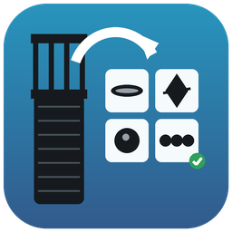

## About this fork

This is Amanda Elineau's (National Oceanography Centre) fork of [NOC-OI/seastar](https://github.com/NOC-OI/seastar). It is where fixes for the IFCB → EcoTaxa processing of NOC cruises are prepared. Each fix goes upstream as its own pull request, so it can be merged on its own:

| Pull request | What it fixes |
|---|---|
| [#11](https://github.com/NOC-OI/seastar/pull/11) | Crashes that hide the real error: `TypeError` on the first missing value (every bin with WHOI ifcb-features v1.3.1 files), `NameError: RuntimeException` |
| [#12](https://github.com/NOC-OI/seastar/pull/12) | An input path that matches no file is reported instead of being dropped without a message |
| [#13](https://github.com/NOC-OI/seastar/pull/13) | `-p` was unknown (`project_name` declared twice); `--help` crashed at `--stationid` |
| [#14](https://github.com/NOC-OI/seastar/pull/14) | The `--bindcol` hint suggests `t` or `f` from the values, instead of always `f` |
| [#15](https://github.com/NOC-OI/seastar/pull/15) | Every column of the feature files goes to EcoTaxa (274 columns instead of 88 with the 240 WHOI v4 features) |
| [#16](https://github.com/NOC-OI/seastar/pull/16) | No depth of 5 m written when `--depth` is not given |

The `main` branch of this fork is the upstream code plus this README: the fixes are in their pull request branches.

## IFCB → EcoTaxa app



A desktop app, in development, that takes an IFCB cruise from the raw files to the EcoTaxa import files without the command line. It is a [Streamlit](https://streamlit.io) page that runs on your own computer, so no data leaves it, and it uses SeaSTAR for the EcoTaxa tables. The code will be published here.

The app follows the folder layout of the NOC IFCB projects:

```
ifcb_sn<serial>_<cruise ID>_<name>/          e.g. ifcb_sn225_ce26008_ar7e
    raw/D<yyyymmdd>/<bin>.hdr .adc .roi
    metadata/
    log/
    whoi_v4_V131_features/features/D<yyyymmdd>/<bin>_features_v4.csv
                          blobs/D<yyyymmdd>/<bin>_blobs_v4.zip
    ecotaxa_import_zip_seastar/
```

| Step | What it does | Status |
|---|---|---|
| 1 · Choose the IFCB project | Opens a project with **Browse…** or creates one with the right folder names. Shows, per day, the number of bins, complete bins (hdr + adc + roi), feature files and EcoTaxa zips, and highlights the days where they differ. | Done |
| 2 · Extract the features | [WHOI ifcb-features](https://github.com/WHOIGit/ifcb-features) v1.3.1 (August 2026): the 30 features of the WHOI MATLAB code and the blob masks. Runs in the background on several cores, skips the bins already done, shows the progress and the time left. The WHOI version (tag and commit) is recorded for each bin and goes to EcoTaxa as `process_feature_extractor` and `process_feature_extractor_release`. | Done |
| 3 · Metadata | Suggests the values instead of typing them: date, time and serial number from the bin name; volume analysed from the `.hdr`; position from the ship navigation; constant fields from the previous day. Then checks them. | Planned |
| 4 · EcoTaxa tables | `seastar ifcb_to_ecotaxa`, with the features, the metadata and the extractor version. | Planned |
| 5 · Quality check | Compares the column names (row 1) and types `[f]`/`[t]` (row 2) of every EcoTaxa table of a project before the upload. | Planned |

On Windows, the app starts from a desktop shortcut: a launcher installs what it needs (Streamlit, WHOI ifcb-features) on the first start and opens the page in the web browser.

---

# SeaSTAR

SeaSTAR (Sea-faring System for Tagging, Attribution and Redistribution) is a CLI and GUI application for processing biodiversity data collected at sea.

## Use cases
Currently SeaSTAR focuses on processing data collected on the IFCB instrument. It has functionality for interactions with EcoTaxa and CRAB.

## How to install and basic use
```
$ pip install seastartool
Collecting seastartool
  Downloading seastartool-0.1-py3-none-any.whl.metadata (1.1 kB)
[...]
Successfully installed seastartool-0.1
```

SeaSTAR has in-built help which you can access using:
```
$ seastar --help
```

For more guides on how to use the software (such as to extract features or generate EcoTaxa tables), see the [wiki](https://github.com/NOC-OI/seastar/wiki).

## An example with the IFCB
Given an example data:
```
raw/
  D20250810/
    D20250810T164958_IFCB225.adc
    D20250810T164958_IFCB225.hdr
    D20250810T164958_IFCB225.roi
    D20250810T171346_IFCB225.adc
    D20250810T171346_IFCB225.hdr
    D20250810T171346_IFCB225.roi
    D20250810T173732_IFCB225.adc
```

### Extracting features (IFCB)
```
$ seastar ifcb_v4_features -i raw/D20250810/*.hdr -o features/D20250810/
```

### Creating EcoTaxa tables
```
$ seastar ifcb_to_ecotaxa -i raw/D20250810/*.hdr ./metadata/A16N_metadata_filtered.csv --operator "Sample Operator" --qcdby "Sample Supervisor" --project "Sample Project" --nonull --ship "Sample Ship" --depth 5 -o
```


